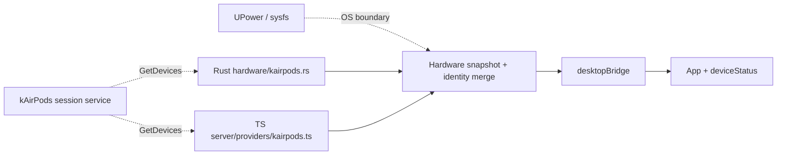

# Дөрвөн GitHub төслийн судалгаа → VoltTray

Шалгасан өдөр: **2026-11-15**. Хэрэгжүүлсэн кодын баталгаажуулалт: AI-agent; хэрэглэгчийн бодит төхөөрөмжийн баталгаа: **PENDING**.

## Хамрах хүрээ

README, лиценз, эх кодын батарей унших → боловсруулах → UI/сануулгад хүргэх сонгосон замуудыг шалгав. Default branch-ийн commit-уудыг тогтоож, эх кодыг тухайн commit-аас уншсан. Дөрвөн төслийг ажиллуулж эсвэл бүх төхөөрөмж дээр туршаагүй. Download хийсэн upstream код/installer ажиллуулаагүй, dependency нэмээгүй.

`python -m src.cli full-scan --repo . --deep-research` нь `No module named src.cli` алдаатай: VoltTray-д AgentCore collector байхгүй. Иймээс GitHub connector ба локал source inspection ашигласан. Workspace нь хүчинтэй Git repository биш (`git status` exit 128); local HEAD/upstream харьцуулалт боломжгүй. Өмнөх scan-ийн өөрчлөлтүүдийг хадгалсан.

## Эх сурвалжийн харьцуулалт

| Төсөл / шалгасан commit | Бодит арга | VoltTray-д авах шийдэл | Хязгаар |
| --- | --- | --- | --- |
| [AirBattery](https://github.com/lihaoyun6/AirBattery/tree/134e02f2861f933b862b2b6a9562a7f55e505e97) · `134e02f` | Swift/CoreBluetooth, BLE `180F`/`2A19`, Apple advertisement parsing; model-д lastUpdate/realUpdate | Олон хэсгийн батарей, мэдээллийн нас ба байхгүй утгыг ялгах | macOS 11+; CoreBluetooth-ийг Windows/Linux Rust backend-д шууд ашиглахгүй. AGPL v3 LICENSE |
| [kAirPods](https://github.com/can1357/kAirPods/tree/9f22f99eac588229acb720213bc15a858f4c620b) · `9f22f99` | Rust L2CAP, session D-Bus JSON, BlueZ battery provider | Ажиллаж буй service-ээс read-only component батарей унших | Linux service хэрэгтэй; GPL v3 LICENSE; service-ийг bundle/хуулбарлаагүй |
| [Übersicht battery bar](https://github.com/gschrader/ubersicht-bluetooth-battery-bar/tree/e0767db89b3add17fb8598be7fab169880e60aef) · `e0767db` | `system_profiler` текстийг shell pipeline-аар шүүж 20 секунд тутам bar зурна | Авсаархан мөр ба цэнэгийн bar | macOS command; localized text parsing ба нэр/хувийн regex нь cross-platform provider болохгүй. MIT |
| [BT Device Battery Info](https://github.com/borferkic/BT-Device-Battery-Info/tree/1c45cc977f2e6298b487cdea11cc9826596d2e51) · `1c45cc9` | Windows PnP/GATT fallback, container identity, refresh/expiry, notification policy | Identity, мэдэгдлийн босго, unknown мэдээллийг зөв харуулах | Windows APIs; coarse controller level-ийг exact percentage гэж үзэхгүй. MIT |

Эдгээрийн UI, protocol implementation эсвэл asset-ийг хуулбарлаагүй. VoltTray-ийн adapter-ийг нийтэд ил D-Bus контрактын дагуу шинээр бичсэн. Лицензийн нэрийг repository LICENSE-ээс тэмдэглэсэн; энэ нь нийлмэл бүтээгдэхүүний хууль зүйн аудит биш.

### AirBattery-ээс тогтоосон зүйл

[BLEBattery.swift](https://github.com/lihaoyun6/AirBattery/blob/134e02f2861f933b862b2b6a9562a7f55e505e97/AirBattery/BatteryInfo/BLEBattery.swift) нь Apple advertisement болон standard BLE characteristic-ийг тусад нь уншдаг. Нэг ерөнхий батарейн command бүх төхөөрөмжийг хамрахгүйг харуулна. [AirBatteryModel.swift](https://github.com/lihaoyun6/AirBattery/blob/134e02f2861f933b862b2b6a9562a7f55e505e97/AirBattery/BatteryInfo/AirBatteryModel.swift) хугацаагаар хуучирсан төхөөрөмжийг шүүдэг боловч updateDevice нь нэрээр солих тул VoltTray-д тэр identity аргыг хэрэглэхгүй.

### kAirPods-ээс тогтоосон зүйл

[parser.rs](https://github.com/can1357/kAirPods/blob/9f22f99eac588229acb720213bc15a858f4c620b/service/src/airpods/parser.rs) packet header, урт, component count шалгаж left/right/case/headphone төлөв гаргана. [dbus.rs](https://github.com/can1357/kAirPods/blob/9f22f99eac588229acb720213bc15a858f4c620b/service/src/dbus.rs) `GetDevices`-ээр JSON string буцаадаг. `device.rs::to_json` дахь `connected` талбарыг бодит эх кодоос баталсан: DBUS_EXAMPLES-ийн жишээ энэ талбарыг оруулаагүй тул жишээг дангаар нь контракт гэж аваагүй.

[battery_provider.rs](https://github.com/can1357/kAirPods/blob/9f22f99eac588229acb720213bc15a858f4c620b/service/src/battery_provider.rs) нь BlueZ-д батарей export хийнэ. Иймээс UPower болон шууд adapter зэрэг ажиллах үед MAC identity-гаар нэгтгэх шаардлагатай. VoltTray GetDevices-ийг 1 секундийн method timeout, auto-start=no тохиргоотой дуудна; эдгээр option-ийн утгыг [systemd busctl documentation](https://www.freedesktop.org/software/systemd/man/latest/busctl.html)-аас шалгасан.

### Windows төслөөс тогтоосон зүйл

[BluetoothService.cs](https://github.com/borferkic/BT-Device-Battery-Info/blob/1c45cc977f2e6298b487cdea11cc9826596d2e51/BTDeviceBatteryInfo/Services/BluetoothService.cs) нь PnP/GATT зэрэг эх сурвалж, физик container, асинхрон хүсэлтийн generation, refresh/expiry-ийг ялгадаг. [BatteryQueryRunner.cs](https://github.com/borferkic/BT-Device-Battery-Info/blob/1c45cc977f2e6298b487cdea11cc9826596d2e51/BTDeviceBatteryInfo/Services/BatteryQueryRunner.cs) эхний хүчинтэй утгыг publish хийсэн ч үлдсэн native ажиллагааны completion-ийг ажигладаг. [LowBatteryNotifier.cs](https://github.com/borferkic/BT-Device-Battery-Info/blob/1c45cc977f2e6298b487cdea11cc9826596d2e51/BTDeviceBatteryInfo/Services/LowBatteryNotifier.cs) төхөөрөмж тус бүрийн notification төлөвтэй. VoltTray-д configurable threshold ба identity-based suppression хэрэгжүүлсэн; WinRT GATT hydration-ийг энэ удаа нэмээгүй.

## Хэрэгжүүлсэн өөрчлөлт

1. **Linux kAirPods provider** — `src-tauri/src/hardware/kairpods.rs`, browser хувилбарт `src/server/providers/kairpods.ts`. JSON envelope, connection, MAC, 0–100 бүхэл утга, charging boolean шалгана. Case-ийг earbuds minimum percentage-д оруулахгүй. Алдаа/байхгүй service → хоосон provider result; 0% болгон хувиргахгүй.
2. **Төхөөрөмжийн identity** — `src/server/hardwareProbe.ts`, `src-tauri/src/hardware.rs`: UPower native path-ийн MAC-ийг нэг хэлбэрт оруулж kAirPods snapshot-тай нэгтгэнэ. Ижил нэртэй өөр MAC-уудыг нийлүүлэхгүй. Charging Bluetooth мөр Bluetooth хэвээр байна.
3. **Үнэн зөв UI** — `src/core/deviceStatus.ts:18`, `src/App.tsx`: live device-д тогтмол 11/33 цагийн суурь тооцоогоор үлдсэн цаг зохиож харуулахаа больсон. Хэмжигдээгүй signal/codec текст болон hardware action-гүй 80% switch-ийг арилгасан. 0% bar үнэхээр хоосон. Left/right/case болон эх сурвалжийг харуулна.
4. **Сануулга** — `src/core/deviceStatus.ts:30`: hardcoded 15%-ийн оронд тохируулсан босго, notificationsEnabled, DND, fullscreen suppression-ийг мөрдөнө. Цэнэг сэргэхэд босго + 5%-ийн hysteresis ашиглаж дахин сануулах эрхийг сэргээнэ. kAirPods/MAC identity-тай төхөөрөмжийн слот солигдоход сануулга давхардахгүй.
5. **Тохиргоо ба алдаа** — `src/App.tsx:114`: давтагдсан snapshot хэрэглэгчийн шинэ тохиргоог дарж бичихгүй; bootstrap settings зөвхөн анх ачаална. Refresh бүтэлгүйтвэл өмнөх мэдээлэл үлдсэнийг banner-аар хэлнэ. Bell товч бодитоор асааж/унтраана.

### Архитектур

Тасралтгүй сум: кодын одоогийн мэдээллийн урсгал. Тасархай сум: гаднын процесс/API boundary.



Provider-specific кодыг тусдаа хавтаст байрлуулсан; ерөнхий UI төлөв/сануулгын дүрэм `src/core/deviceStatus.ts`-д байна. Rust/TS нь хоёр тусдаа runtime тул нэг хэлний source-ийг нөгөөд import хийх боломжгүй; хоёр parser-ийг ижил edge case-уудаар шалгасан.

## Баталгаажуулалт ба хил

- TypeScript lint, npm tests, Vite build: амжилттай (6 test file-level үр дүн; individual test count гэж ойлгохгүй).
- Rust parser болон autostart regression tests: амжилттай; эцсийн тоог evidence/validation.json-д тэмдэглэнэ.
- Desktop Debian installer: build-ийн эцсийн үр дүнг evidence/validation.json-д тэмдэглэнэ. AppImage packaging энэ удаа ажиллуулаагүй.
- Live `busctl --user ... GetDevices`: **ENV FAILURE**, `Operation not permitted`. Энэ нь kAirPods байхгүй эсвэл AirPods дэмжихгүйг нотлохгүй; sandbox-аас session bus-д хандах боломжгүй.
- Native GUI/visual, бодит AirPods, Windows runtime, hidden-window notification ажиллагаа **баталгаажаагүй**.

### Үлдсэн инженерийн ажил

- MAC/identity өгдөггүй хуучин sysfs/HID provider-уудын heuristic dedup хэвээр; бүх төхөөрөмжийн identity-г бүрэн шийдсэн гэж үзэхгүй.
- `capacity_level`-ийг төлөөлөх хувьд хувиргадаг хуучин provider-уудыг цаашдаа coarse level төрөлтэй болгох. Windows төслийн `BatteryLevel.cs` энэ ялгааг хэрэгжүүлдэг.
- Provider өөрийн хэмжилтийн timestamp өгөөгүй үед UI-ийн хүлээн авсан цаг физик хэмжилтийн freshness-ийг батлахгүй. Native background alerts болон per-provider stale/timeout diagnostics дараагийн тусдаа ажил.
- Windows PnP-ийг WinRT GATT + container identity-гаар өргөтгөхөд Windows төхөөрөмж дээрх regression шаардлагатай.

Локал дахин шалгах:

```bash
cd /home/light/Projects/battery
npm run lint
npm test
cargo test --manifest-path src-tauri/Cargo.toml --locked --offline
npm run tauri:build -- --bundles deb
```

Бодит hardware хүлээн авах алхмууд: [AirPods заавар](../../../airpods.md). Эх сурвалжийн URL, commit, anchor мөрүүд: [sources.json](evidence/sources.json). API request, token, хэрэглэгчийн account usage нь өөр хэмжигдэхүүнүүд; provider-ийн token/charge мэдээлэл энэ судалгаанд байхгүй, тооцож зохиогоогүй.
